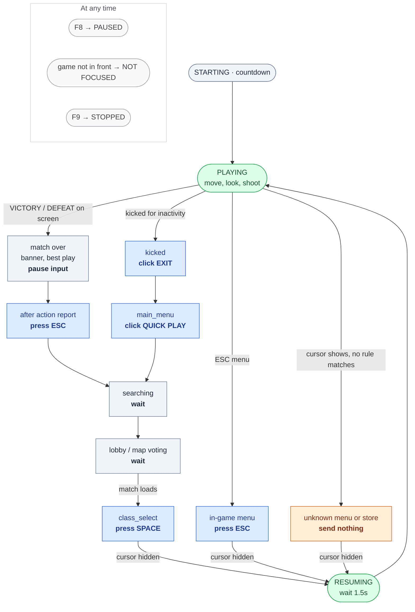

# anti-afk-bot

Keeps you from getting kicked for inactivity while you're away from the game.

> Using automation in online games may break the game's terms of service and can get your
> account banned. Use it at your own risk.

## Getting started (step by step)

You don't need to install anything else. Steps 1 and 2 are only needed once.

### 1. Download the app

1. Go to the [latest release](https://github.com/metalglove/anti-afk-bot/releases/latest).
2. Under **Assets**, click the file whose name ends in **-windows.zip** (for example
   `AntiAFK-v1.0.0-windows.zip`). It downloads to your Downloads folder.

### 2. Unzip it

1. Open your Downloads folder, right-click the ZIP and choose **Extract All...**.
2. Choose where to put it. Your **Desktop** or **Documents** is best (not "Program Files",
   because then the app can't update itself). Click **Extract**.
3. You now have a folder called `AntiAFK`. Keep everything in it together.

Tip: right-click `AntiAFK.exe` and choose **Send to → Desktop (create shortcut)** so you can
start it from your desktop.

### 3. Start the app

Double-click **AntiAFK.exe** in the `AntiAFK` folder. The Anti-AFK window opens.

The first time, Windows may show a blue box saying **"Windows protected your PC"**. That's
because the app is new and not from a big company. Click **More info**, then **Run anyway**.
You only have to do this once (and once more after an update, sometimes).

### 4. Use it

1. Start the game and set its display mode to **Borderless** or **Windowed** (not
   Fullscreen), so the bot can read the screen.
2. In the app, click **Test run** and switch to the game. The bot reads the screens and
   shows in the Activity log what it *would* do, without touching anything. Check that the
   menus are recognized.
3. Happy with it? Click **Stop**, then **Start**, and switch to the game within 5 seconds.

| Key (in the game) | What it does |
| --- | --- |
| F8 | Pause / resume the bot |
| F9 | Stop the bot |

The game is set to `cod.exe`. For another game, open **Settings**, click **Detect** and
then click on the game window.

### Updates

The app checks for a new version every time it starts. When there is one, a blue
**Update to ...** button shows at the top of the window:

1. Click it, then click **Yes**.
2. Wait a few seconds. The app closes, updates, and opens again by itself.

Your settings and match history are kept. You can also check yourself under
**Settings → Check for updates**.

### Something went wrong?

| Problem | Fix |
| --- | --- |
| "Windows protected your PC" | Click **More info**, then **Run anyway**. |
| Windows says the file is a virus or deletes it | Some antivirus programs don't trust new apps. Download it again from the release page; if it keeps happening, ask whoever maintains the bot. |
| The bot does nothing in the game | Use Borderless or Windowed mode. If the game runs as administrator, close the app, right-click `AntiAFK.exe` and choose **Run as administrator**. |
| The update says it can't write to the folder | Move the whole `AntiAFK` folder to your Desktop or Documents and start it from there. |
| The update didn't work | Download the newest ZIP from the [release page](https://github.com/metalglove/anti-afk-bot/releases/latest) and unzip it over your old `AntiAFK` folder (choose to replace the files). |
| A screen isn't recognized | Open the **Screens** page, press **Read screen**, switch to the game, and send the text it shows to whoever maintains the bot. |

## The app

The app has four pages: **Dashboard** (what the bot is doing right now, a live state
diagram, stats and the activity log), **History** (every recorded match), **Screens** (the
known screens from `rules.json`, and **Read screen** to check one) and **Settings** (game,
start delay, menu read interval, and whether it runs as administrator). Settings are
remembered between runs.

Prefer the terminal? `python anti_afk.py` does the same. The game defaults to `cod.exe`
(`--game` for another one, `--help` for options, `--test` for test mode).

An update replaces `rules.json` with the one from the new version. If you had changed
yours, the old one is saved as `rules.json.bak` next to it.

## Running from source (for developers)

Needs Python 3.11 to 3.14 (3.13 recommended; 3.15 doesn't work yet because onnxruntime has
no build for it):

```
py -3.13 -m pip install -r requirements.txt
py -3.13 app.py
```

Running from source doesn't update itself; use `git pull`.

## Making a release

Push a version tag, for example:

```
git tag v1.0.0
git push origin v1.0.0
```

GitHub Actions ([`.github/workflows/release.yml`](.github/workflows/release.yml)) builds
`AntiAFK.exe` with PyInstaller, checks that it starts, zips the `AntiAFK` folder as
`AntiAFK-v1.0.0-windows.zip` and publishes it as a GitHub release. Everyone's app then
offers the update the next time it starts. Versions are compared as numbers, so always
tag a higher version than the last one. Every pull request also builds the app; it's
under **Artifacts** on the workflow run, for testing before a release.

### How the automatic update works

1. A few seconds after AntiAFK.exe starts, it asks GitHub for the latest release
   ([`updater.py`](updater.py)). If that version is higher than its own and the release has
   an `AntiAFK-v...-windows.zip`, a blue **Update to ...** button shows in the header.
   Without internet nothing happens. **Settings → Check for updates** does the same on demand.
2. Nothing installs by itself: the player clicks the button and confirms, so it never
   restarts during a game.
3. The app stops the bot, downloads the ZIP to a temporary folder and unpacks it, starts a
   small helper script, and closes.
4. The helper waits for the app to close, copies the new files over the `AntiAFK` folder
   (`settings.json` and `matches.csv` are kept; a changed `rules.json` is saved as
   `rules.json.bak`), starts the new version and deletes the temporary folder.

If the folder can't be written to (for example under Program Files) or the download fails,
the app says so and links to the release page. Running from source never updates itself, so
anyone still on the Python version has to download the app once.

# How it works

## What the bot is doing

The terminal prints every state change with the time, and the terminal's title shows the
current state:

```
[21:04:12] SCREEN: kicked (clicking EXIT)   (after 3m10s PLAYING)
[21:04:16] SCREEN: main_menu (clicking QUICK PLAY)
[21:04:21] SCREEN: searching (waiting)
[21:05:31] SCREEN: class_select (pressing SPACE)
[21:05:34] RESUMING: playing in 1.5s   (after 1m18s SCREEN)
[21:05:35] PLAYING   (after 1s RESUMING)
```



| State | Meaning |
| --- | --- |
| STARTING | Countdown before it begins |
| PAUSED | You pressed F8 |
| NOT FOCUSED | The game isn't the window in front |
| PLAYING | In a match: the only state where it moves, shoots and presses keys |
| RESUMING | A menu just closed; it waits a moment before playing |
| SCREEN | A screen listed in `rules.json` (see below); it clicks that screen's button, presses its key, or waits. Also `post_match`: input stays paused from VICTORY / DEFEAT until the next match |
| MENU | A menu it doesn't know, or one showing STORE, PURCHASE etc.: it sends nothing |

## Match time

Each match is timed from the moment play starts until VICTORY / DEFEAT, the After Action
Report, a kick, or the main menu (or until you stop the bot mid-match). Finished matches are added to
`matches.csv`, so the total keeps adding up across runs. The app shows the session and
all-time totals on the Dashboard and every match on the **History** tab. Test runs aren't
recorded.

## Menus and the store

Input pauses whenever the mouse cursor is showing, which is how the game looks in menus,
the lobby and the store, so the bot can't click its way into a purchase. It resumes a
moment after the menu closes. Run `python anti_afk.py --show-menu` and open a few menus
to check that it says `MENU` there and `playing` in a match.

### Which menu is it? (rules.json)

While a menu is open, the bot takes a screenshot of the game window and reads the text on
it: as soon as the menu opens, right after each click, and every 3 seconds in between
(**Menu read interval** in the app, `--read-interval` on the command line). During a match
it only reads every 5 seconds to spot the end of the match (see below). `rules.json` says
which screen has which words and what to do there:

```json
{"name": "kicked",       "if_seen": ["KICKED FOR INACTIVITY"],  "click": "EXIT"},
{"name": "searching",    "if_seen": ["SEARCHING FOR A MATCH"]},
{"name": "main_menu",    "if_seen": ["QUICK PLAY", "FEATURED"], "click": "QUICK PLAY"},
{"name": "main_menu_hardcore", "if_seen": ["HARDCORE", "FEATURED"], "click": "HARDCORE"},
{"name": "report",       "if_seen": ["AFTER ACTION REPORT"],    "press": "ESC"},
{"name": "pause_menu",   "if_seen": ["RETURN TO GAME", "LEAVE MATCH"], "press": "ESC"},
{"name": "class_select", "if_seen": ["SELECT CLASS"],           "press": "SPACE"}
```

A screen matches when all its `if_seen` words are on screen; the bot then clicks the text
in `click` (wherever it is), presses the key in `press`, or just waits if it has neither. It never clicks while any
word in `never_click_if_seen` (STORE, PURCHASE, BUY, COD POINTS...) is visible, and a menu
that matches no rule gets no input at all. Because it reads words instead of pixel
positions, it works at any resolution or window size.

Rules with `"in_match": true` are also checked during a match, every 5 seconds, even
without a cursor. The VICTORY and DEFEAT banners are set up this way, so the bot stops
moving and shooting as soon as a match ends. These rules only pause input; they never click.
The BEST PLAY replay after the banner is one too (`best_play`); it only shows after a match.

After VICTORY / DEFEAT the bot stays in `post_match` with input paused until a pre-match
screen (searching, lobby, class select, main menu) shows up, so the screens after the banner
aren't mistaken for a new match. If none shows up within 5 minutes it plays again anyway.

Rules are checked from top to bottom and the first match wins. The After Action Report
also shows "SEARCHING FOR A MATCH" in its corner, so its rules (`report_victory`,
`report_defeat`, `report`) come before `searching`, and `searching` comes before
`main_menu` so the bot never clicks QUICK PLAY while a search is running. If Hardcore is
selected, the big play button says HARDCORE instead of QUICK PLAY; `main_menu_hardcore`
clicks that one. When the text to click appears more than once, the bot clicks the
biggest one, so it's the big play button and not the small HARDCORE tag on a mode tile. The report
records the match as a victory or defeat (in case the bot missed the banner), then the
bot presses ESC to dismiss it.

The in-game menu (ESC during a match) is `pause_menu`: the bot presses ESC to go back into
the match. It never clicks there, so LEAVE MATCH and QUIT TO DESKTOP are never touched.
While you're tabbed out the game isn't in front, so the bot sends nothing at all.

A `press` has the same safety checks as a click: a fresh read must still show the same
screen, with no `never_click_if_seen` word on it.

To add a screen, open it in the game and click **Read screen** in the app (or run
`python anti_afk.py --read-screen`). After 3 seconds it prints the text it sees and which
rule matches. Pick a few words that are only on that screen, add a rule with **Edit**, and
check it with a **Test run**. The screen has to be readable, so use borderless or windowed
mode, not exclusive fullscreen. The first read takes a few seconds while the text
recognition model loads.

### Games that draw their own menu cursor

If it still says `playing` in a menu (some games draw their own cursor), pick a spot of
the HUD that is only there while playing, such as part of the minimap frame. Take an
in-game screenshot and read its X,Y in Paint, then run
`python anti_afk.py --show-menu --ingame-pixel X,Y` in a match to read its color, and
start the bot with `--ingame-pixel X,Y,RRGGBB`. Input then only goes out while that pixel
matches. This needs borderless or windowed mode; in exclusive fullscreen the pixel can't
be read and the bot stays paused.

More options: `python anti_afk.py --help`
