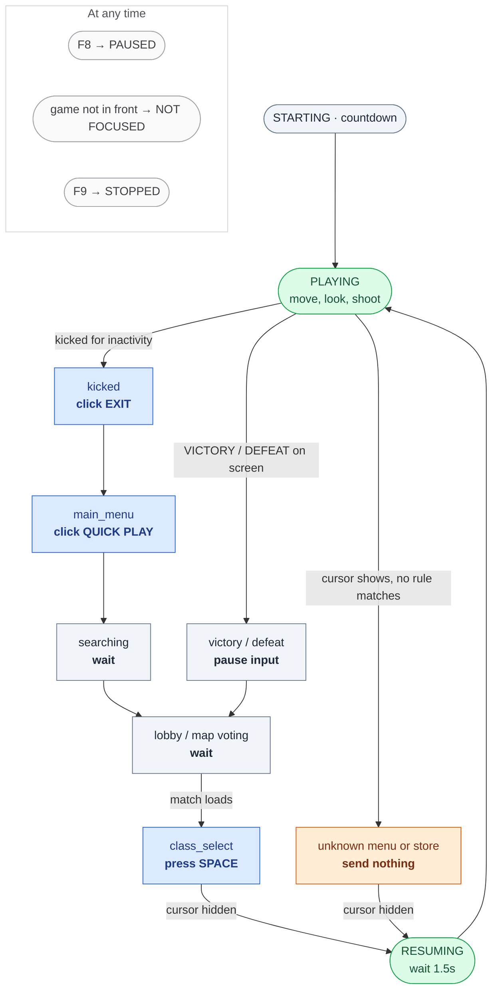

# anti-afk-bot

Keeps you from getting kicked for inactivity while you're away from the game.

## Setup

```
pip install -r requirements.txt
```

## Run

Run `python app.py` in this folder to open the app. Administrator rights aren't needed,
unless the game itself runs as administrator: Windows doesn't let a normal program send
input to an elevated one, so then start the terminal as administrator too.

1. Click **Detect** and then click on the game, or type its exe name (e.g. `cod.exe`).
2. Click **Start** and switch to the game.

The big bar at the top shows what the bot is doing right now. **Test (send nothing)** runs
everything except the input, so you can walk through the menus and check that each screen
is recognized before letting it play. Settings are remembered between runs.

| Key | Action |
| --- | --- |
| F8 | Pause / resume |
| F9 | Stop |

Using automation in online games may break the game's terms of service and can get your
account banned.

Prefer the terminal? `python anti_afk.py --game cod.exe` does the same (`--help` for options,
`--test` for test mode).

## What the bot is doing

The terminal prints every state change with the time, and the terminal's title shows the
current state:

```
[21:04:12] SCREEN: kicked (clicking EXIT)   (after 3m10s PLAYING)
[21:04:16] SCREEN: main_menu (clicking QUICK PLAY)
[21:04:21] SCREEN: searching (waiting)
[21:05:31] SCREEN: class_select (pressing SPACE)
[21:05:34] RESUMING: playing in 1.5s   (after 1m18s SCREEN)
[21:05:35] PLAYING   (after 1s RESUMING)
```



| State | Meaning |
| --- | --- |
| STARTING | Countdown before it begins |
| PAUSED | You pressed F8 |
| NOT FOCUSED | The game isn't the window in front |
| PLAYING | In a match: the only state where it moves, shoots and presses keys |
| RESUMING | A menu just closed; it waits a moment before playing |
| SCREEN | A screen listed in `rules.json` (see below); it clicks that screen's button |
| MENU | A menu it doesn't know, or one showing STORE, PURCHASE etc.: it sends nothing |

## Match time

Each match is timed from the moment play starts until VICTORY / DEFEAT, the After Action
Report, a kick, or the main menu (or until you stop the bot mid-match). Finished matches are added to
`matches.csv`, so the total keeps adding up across runs. The app shows the session and
all-time totals on the Dashboard and every match on the **History** tab. Test runs aren't
recorded.

## Menus and the store

Input pauses whenever the mouse cursor is showing, which is how the game looks in menus,
the lobby and the store, so the bot can't click its way into a purchase. It resumes a
moment after the menu closes. Run `python anti_afk.py --show-menu` and open a few menus
to check that it says `MENU` there and `playing` in a match.

### Which menu is it? (rules.json)

While a menu is open, the bot takes a screenshot of the game window and reads the text on
it: as soon as the menu opens, right after each click, and every 3 seconds in between
(**Menu read interval** in the app, `--read-interval` on the command line). During a match
it reads nothing. `rules.json` says which screen has which words and what to click:

```json
{"name": "kicked",       "if_seen": ["KICKED FOR INACTIVITY"],  "click": "EXIT"},
{"name": "searching",    "if_seen": ["SEARCHING FOR A MATCH"]},
{"name": "main_menu",    "if_seen": ["QUICK PLAY", "FEATURED"], "click": "QUICK PLAY"},
{"name": "report",       "if_seen": ["AFTER ACTION REPORT"],    "press": "ESC"},
{"name": "class_select", "if_seen": ["SELECT CLASS"],           "press": "SPACE"}
```

A screen matches when all its `if_seen` words are on screen; the bot then clicks the text
in `click` (wherever it is), or just waits if there is no `click`. It never clicks while any
word in `never_click_if_seen` (STORE, PURCHASE, BUY, COD POINTS...) is visible, and a menu
that matches no rule gets no input at all. Because it reads words instead of pixel
positions, it works at any resolution or window size.

Rules with `"in_match": true` are also checked during a match, every 5 seconds, even
without a cursor. The VICTORY and DEFEAT banners are set up this way, so the bot stops
moving and shooting as soon as a match ends. These rules only pause input; they never click.

Rules are checked from top to bottom and the first match wins. The After Action Report
also shows "SEARCHING FOR A MATCH" in its corner, so its rules (`report_victory`,
`report_defeat`, `report`) come before `searching`, and `searching` comes before
`main_menu` so the bot never clicks QUICK PLAY while a search is running. The report
records the match as a victory or defeat (in case the bot missed the banner), then the
bot presses ESC to dismiss it.

Instead of `click`, a rule can have `"press": "ESC"` (or another key) to press that key
on the screen. It has the same safety checks as a click.

To add a screen, open it in the game and click **Read screen** in the app (or run
`python anti_afk.py --read-screen`). After 3 seconds it prints the text it sees and which
rule matches. Pick a few words that are only on that screen, add a rule with **Edit**, and
check it with a **Test run**. The screen has to be readable, so use borderless or windowed
mode, not exclusive fullscreen. The first read takes a few seconds while the text
recognition model loads.

### Games that draw their own menu cursor

If it still says `playing` in a menu (some games draw their own cursor), pick a spot of
the HUD that is only there while playing, such as part of the minimap frame. Take an
in-game screenshot and read its X,Y in Paint, then run
`python anti_afk.py --show-menu --ingame-pixel X,Y` in a match to read its color, and
start the bot with `--ingame-pixel X,Y,RRGGBB`. Input then only goes out while that pixel
matches. This needs borderless or windowed mode; in exclusive fullscreen the pixel can't
be read and the bot stays paused.

Using automation in online games may break the game's terms of service and can get your
account banned.

More options: `python anti_afk.py --help`
